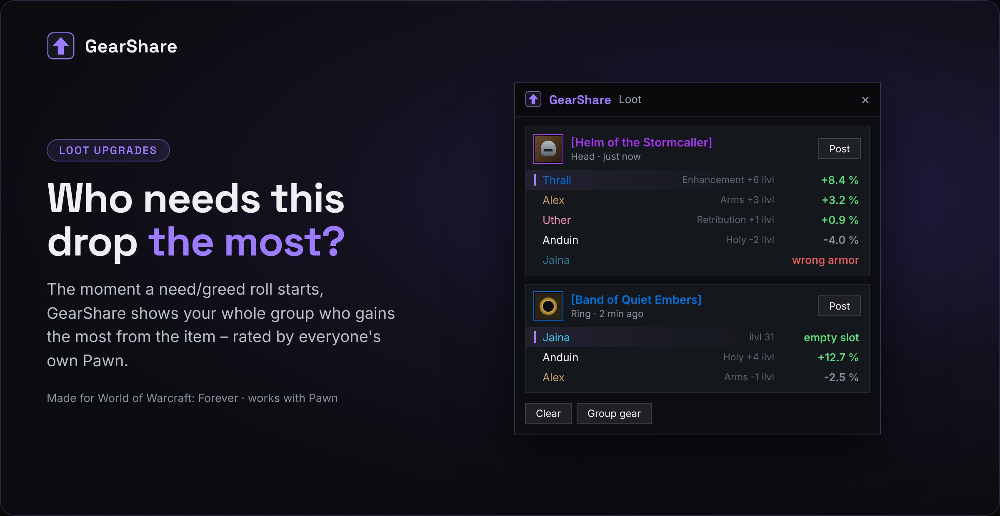

# GearShare



**Who in your group gets the biggest upgrade from a drop?** GearShare for
**World of Warcraft: Forever** (interface 16001) answers this when a need/greed
roll starts. Everyone in the group rates the drop with their **own Pawn
scales**, and every GearShare in the group shows the same ranking:

```
[Raging Berserker's Helm]          Head · just now     [Post]
▌ Thrall      Enhancement  +6 ilvl     +8.4 %
  Alex        Arms         +3 ilvl     +3.2 %
  Anduin      Holy         -2 ilvl     -4.0 %
  Jaina                            wrong armor
```

## How it works

- **Each player rates for themselves.** Your client can't see anyone else's
  Pawn scales, and inspecting only works up close and out of combat. So each
  GearShare asks its own Pawn what the drop is worth compared with the gear that
  player wears, and sends the answer to the group as a short addon message.
- **The comparison:** the best Pawn scale shown for your character counts.
  Rings and trinkets are compared with the weaker of the two you wear, a
  two-hander with main hand + off hand together, an off-hand item next to a
  two-hander with half the two-hander. Items you can't roll need on, and armor
  that isn't your type, count as "can't use".
- **Without Pawn**, or for items Pawn can't score (many trinkets), the item
  level decides.
- **Group gear** (`/gs gear`): everyone's gear slot by slot with item levels.
  Each player's two weakest slots are marked.

Everyone in the group needs GearShare. Pawn is strongly recommended.

## Commands

| Command | |
|---|---|
| `/gs` | open/close the loot window |
| `/gs gear` | the group's gear, slot by slot |
| `/gs check [item]` | ask the group to rate an item (shift-click it in) |
| `/gs auto on\|off` | open the loot window by itself when something drops |
| `/gs clear` | empty the loot window |
| `/gs test` | a made-up drop with made-up members, to try the window |

The addon list button (in the minimap corner): left click opens the loot window,
right click opens the group gear.

## Language

English and German (follows the game's language).

## Licence

MIT, see `LICENSE`. Development notes: [docs/DEVELOPMENT.md](docs/DEVELOPMENT.md).
