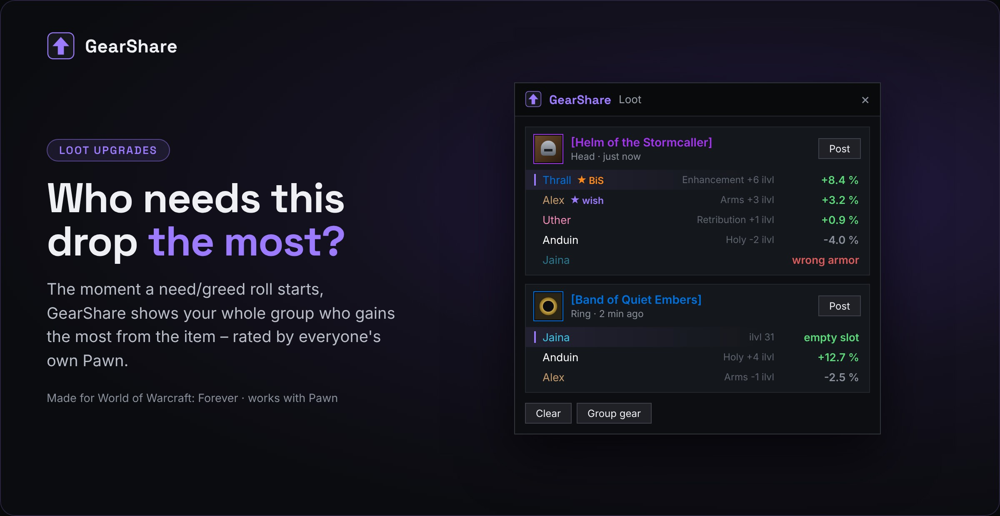
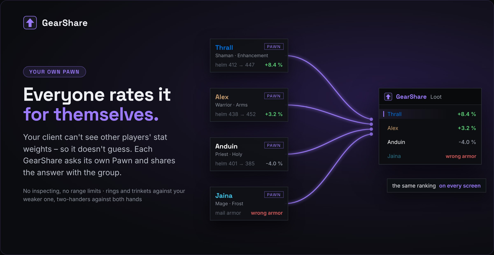
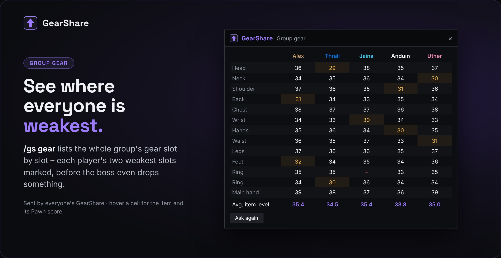
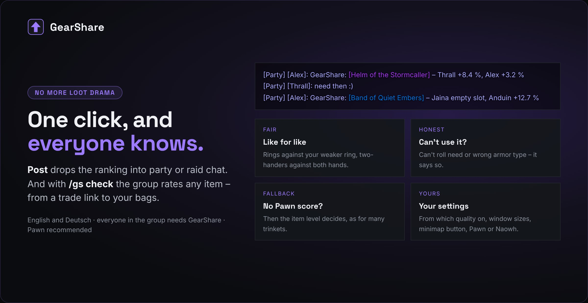
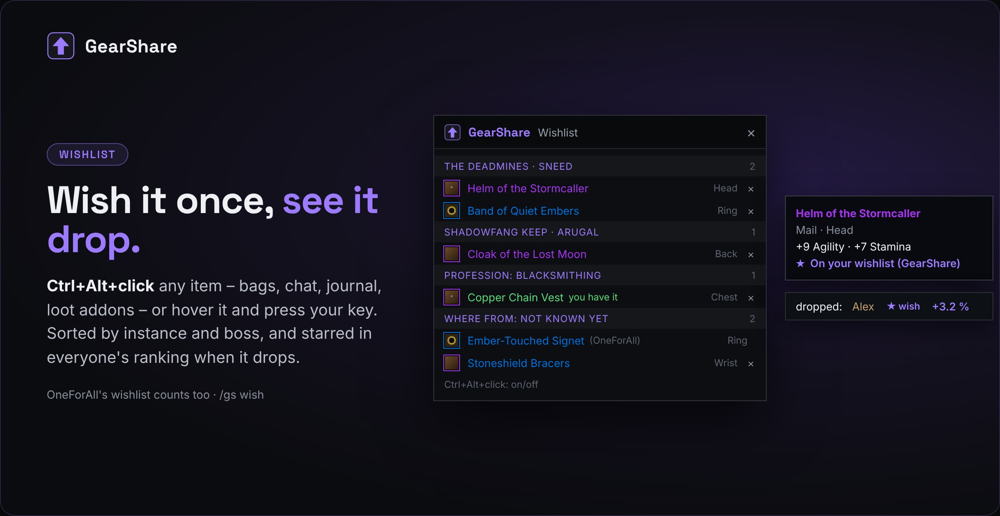

## Who needs this drop the most?

**GearShare** shows your group, the moment a need/greed roll starts, **who gets the biggest upgrade** from the item – rated by every player's **own Pawn scales** against the gear they actually wear.

- **Everyone rates for themselves:** each GearShare asks its own Pawn and shares the answer with the group – no inspecting, no guessing other people's stat weights
- **Fair comparisons:** rings and trinkets against your weaker one, two-handers against main hand + off hand, off-hand items next to a two-hander against half of it
- **Can't use it?** Items you can't roll need on and the wrong armor type are marked as such
- **No Pawn score?** Then the item level decides (many trinkets)
- **Naowh Forever:** drops on someone's Naowh BiS list get a ★ in the ranking, and Naowh's Stat Weights can rate drops instead of Pawn
- **Post** the ranking to party or raid chat with one click
- **Wishlist** (`/gs wish`): Ctrl+Alt+click any item, or hover it and press your GearShare key – grouped by instance and boss; OneForAll's wishlist counts too. Wished drops get a ★ in everyone's ranking
- **Group gear** (`/gs gear`): everyone's gear slot by slot, with each player's weakest slots marked
- **Your settings** (`/gs options`): from which quality on drops show up, window sizes, rate with Pawn or Naowh, minimap button

Made for **World of Warcraft: Forever**. English and German.

## Requirements

- **Everyone in the group** needs GearShare – it's the group's addons that talk to each other.
- **Pawn** is strongly recommended (optional). Without it, item level is used.
- Optional: **Naowh Forever** (BiS stars, its stat weights) and **OneForAll** (its wishlist counts too).

## Commands

| Command | |
|---|---|
| `/gs` | open/close the loot window |
| `/gs gear` | the group's gear, slot by slot |
| `/gs check [item]` | ask the group to rate any item (shift-click it in) |
| `/gs auto on/off` | open the loot window by itself when something drops |
| `/gs clear` | empty the loot window |
| `/gs test` | a made-up drop with made-up members, to try it out alone |
| `/gs wish [item]` | your wishlist; with an item: put it on or off |
| `/gs options` | settings: which drops, window sizes, Pawn or Naowh, minimap button, … |
| `/gs debug` | what GearShare finds of Pawn and Naowh |

Minimap button: left click opens the loot window, right click the group gear, Ctrl-click the wishlist, middle or shift-click the settings. Key binding for the wishlist: *Key Bindings → AddOns → GearShare*.

## Source

[github.com/Drakner-chio/Gearshare](https://github.com/Drakner-chio/Gearshare) – MIT licence. Bugs and ideas welcome as issues.
